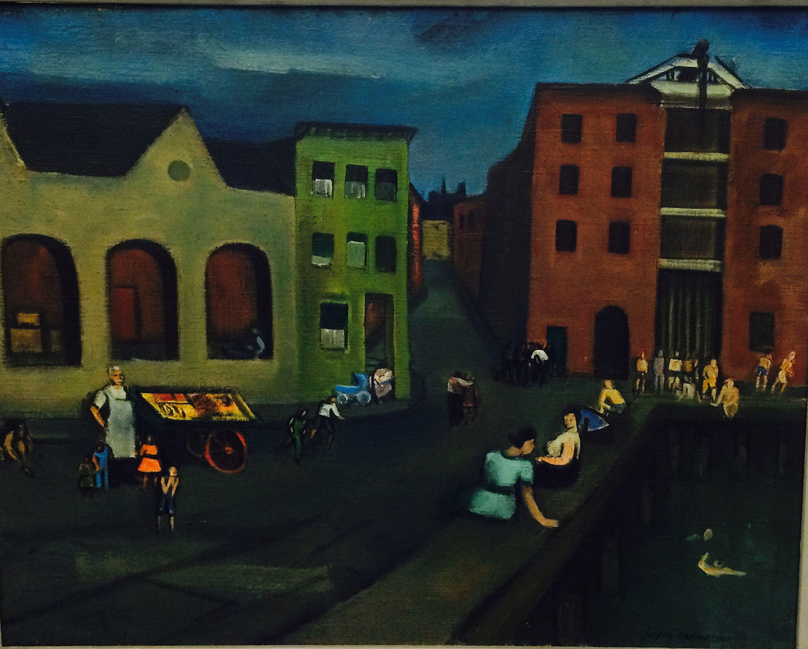
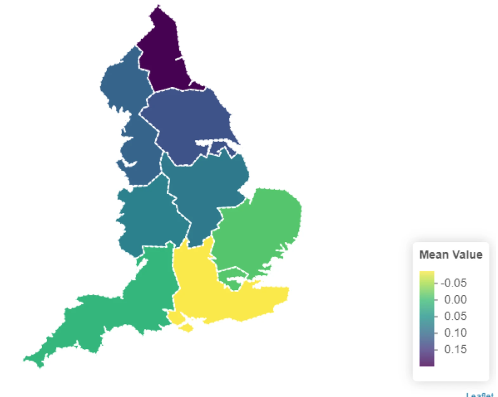

```{r setup, include=FALSE}
knitr::opts_chunk$set(echo = TRUE)

library("rmarkdown")
library("yaml")
library("blogdown")
library("knitr")
library("blogdown")

blogdown::install_hugo

```


```{r, echo=FALSE, out.width="75%", fig.align = 'center', fig.cap="Joseph De Martini - Docks on Sunday"}

```


### Background
Social exclusion has been used as a useful framework for understanding cumulative and intersecting social disadvantages, reflecting the processes by which individuals are prevented from fully participating in society. Social exclusion reflects a nuanced understanding of marginalisation and disadvantage, encompasing material, digital, relational, political, and structural domains. [We have previously done work defining and describing social exclusion in the UK](https://pubmed.ncbi.nlm.nih.gov/37160438/). 

### Why did we do this research?
While growing evidence shows the importance of the social determinants of mental health, there is little evidence looking the link between social exclusion and mental health problems. 

### What did we do?
*Study population:* We used data from Understanding Society, the UK Household Survey. This includes over 30,000 adults in the UK. 


*Exposure - social exclusion:* 
We measured social exclusion using information collected in Wave 11 (2019-21) with some additional data drawn from earlier waves of the survey. We measured 5 domains of social exclusion: material, relational, digital, political, and structural using multiple measures, then summarised using principal component analysis (PCA). 


*Outcome - mental health problems* 
We estimated mental health problems based on answers to the 12-item General Health Questionnaire (GHQ) which measures psychological distress and common mental disorders, including symptoms of anxiety and depression. This was scored from 0 (no symptoms of mental health problems) to 36 (high burden of symptoms of mental health problems). We also used the established cutoff of 12, to estimate mental health caseness, indicating a level of symptoms commensurate with a clinical diagnosis of anxiety or depression.  


*Analysis:* We first calculated descriptive statistics on the sample. We fitted survey-weighted linear regression models, adjusted for age, sex, and ethnicity. We also used multiple imputation to account for missing data. 


```{r, echo=FALSE, out.width="75%", fig.align = 'center', fig.cap="Geographic distribution of social exclusion in England, darker colour indicates higher levels of social exclusion"}

```


### What did we find?

Each standard deviation increase in overall social exclusion was associated with a 1.28-point increase in GHQ-12 symptoms (95%CI 1.11-1.44). The domains with the strongest associations with mental health problems were material exclusion (1.34-point increase, 95% CI: 1.20,1.47) and relational exclusion (1.37, 95% CI:1.09,1.65).

### What does this mean?

Social exclusion was assocated with worse mental health, with strongest effects for relational and mateiral domains. Policies targetting these domains may have the largest impact on population health. 


### Read more

You can read the full open-access paper here [Social Psychiatry and Psychiatric Epidemiology](https://link.springer.com/article/10.1007/s00127-026-03196-z). 


### Open science

*Pre-registered protocol:* [OSF](https://osf.io/d9yfz/overview)


### Behind the research

[Dr Michelle Arellano Spano](https://profiles.ucl.ac.uk/100729-michelle-arellano-spano) led this research, as part of her post-doctoral work. In addition to her work exploring the social determinants of mental health, she has a background in genetic epidemiology, exploring intergenerational transmission of health and behaviours. 